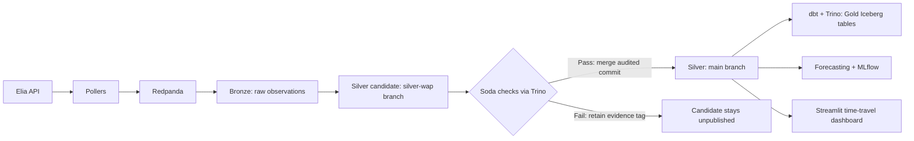

# GridTime

A bitemporal lakehouse for the Belgian electricity grid, built on [Elia Open Data](https://opendata.elia.be).

Elia's grid data is revised after the fact: forecasts are refreshed every minute, and near-real-time
values are published as non-validated and later replaced by validated ones. GridTime keeps **every
version** of every value, stamped with two times:

- `valid_time` (Bronze) / `valid_from`–`valid_to` (Silver) – the interval the value describes, usually one minute
- `transaction_time` – when GridTime received it

That makes "as-of" questions answerable: *what did we know about 14:00–14:15 at 14:07?* This is the
foundation for honest forecast evaluation without data leakage.


**Time travel.** The *As known at* slider rewinds the dashboard to any past moment. Rewound to
13:59:45, the historical feed (which arrived at 14:00:54) disappears, because GridTime did not
know it yet:


## Architecture



| Component | What it does in GridTime |
|---|---|
| MinIO + Iceberg | Store data files and table metadata, including successive table snapshots. |
| Redpanda | Buffer observations between polling Elia and committing Bronze. |
| Nessie | Track table metadata pointers and isolate the candidate Silver update on a branch. |
| Trino + dbt | Query Iceberg directly and build the Gold analytical tables. |
| Soda | Run the declared quality checks; reject a failing Silver candidate before publication. |
| Dagster | Schedule polling, coordinate downstream work, and display materializations and checks. |
| scikit-learn + MLflow | Train the forecasting models and record evaluation results. |

The dashboard reads published Silver. The candidate branch is not visible there until
its checks pass and the merge succeeds. Bronze is the raw observation history; Silver
contains typed, versioned measures; Gold contains tables designed for analysis.

See [docs/architecture.md](docs/architecture.md).

## Milestones

| # | Milestone | New tools | Status |
|---|-----------|-----------|--------|
| 1 | Ingest Elia data into Bronze | MinIO, Iceberg (PyIceberg) | Done |
| 2 | Bitemporal Silver layer | – | Done |
| 3 | Orchestration + Gold models | Dagster, dbt | Done |
| 4 | Streaming buffer | Redpanda | Done |
| 5 | Forecasting + evaluation | scikit-learn, MLflow | Done |
| 6 | Platform upgrade | Trino, Nessie, Soda | Done |

## Quick start

Requirements: Docker, Python 3.12 or newer, [uv](https://docs.astral.sh/uv/).

```bash
cp .env.example .env
make up        # start MinIO, Redpanda, Nessie and Trino
make install   # install Python dependencies
make init      # create the Iceberg tables
make ingest    # poll Elia once into Redpanda, then drain the topics into Bronze
make silver    # write Silver on a branch, audit with Soda, merge only on pass
make gold      # build and test Gold Iceberg tables through Trino
make peek      # query Bronze with DuckDB
make dashboard # open the dashboard at http://localhost:8501
```

For forecasting on a new installation, backfill history, drain it into Bronze, and
train the first model **before** enabling the full scheduled pipeline:

```bash
make backfill
uv run python -m gridtime.ingestion.bronze_sink --once
# If the sink reports lag > 0, repeat the command until lag is 0.
make silver
make gold
make forecast
```

Backfill rows retain the time they were actually fetched as their knowledge timestamp;
eight weeks of historical measurements do not create eight weeks of as-known history.

Then let Dagster run the pipeline: near-real-time polling every five minutes,
historical polling hourly at :07, and retraining daily at 06:13 (Europe/Brussels).
Bronze, Silver, Gold and live forecasts update downstream. Keep the daemon running,
and avoid running standalone ingestion writers alongside it.

```bash
make orchestrate   # Dagster UI at http://localhost:3000
```


*Earlier streaming milestone: this screenshot shows the dependency graph. The
milestone 6 run and its quality checks are shown below.*

## Streaming

Pollers publish every observation to Redpanda (`elia.ods175`, `elia.ods165`); invalid
records go to `elia.dlq`. The Bronze sink drains the topics, drops payloads Bronze already
has, appends the rest and only then commits offsets: at-least-once delivery, exactly-once
storage. See [decisions/004](docs/decisions/004-streaming-buffer.md).


## Forecasting

GridTime forecasts the mean system imbalance of the next two quarter-hours and evaluates the
forecasts **as they would have been known**. The same feature function runs on the latest
data (the usual, optimistic backtest) and on Silver *as of* each decision time, where the last
minutes of the previous quarter-hour have often not been published or polled yet.

These are the **initial revised-data results recorded on 15 October 2026**, not
measured as-known performance:

| Next quarter-hour (4-week walk-forward, 2,640 decisions) | MAE | Skill vs persistence | Sign right | 80% interval coverage |
|---|---|---|---|---|
| Gradient boosting (quantile, conformal) | 69 MW | **+18%** | 82% | 81% |
| Persistence | 85 MW | 0% | 80% | 82% |
| Climatology (by quarter-hour of day) | 136 MW | −61% | 57% | 80% |
| Same quarter-hour yesterday | 175 MW | −106% | 57% | 83% |

In this backtest, repeating the last value outperformed using yesterday's value.
Gradient boosting reduced average absolute error from 85 MW to 69 MW. Its nominal
80% interval contained the observed target in 81% of evaluated cases; that is an
empirical result for this period, not a guarantee for future forecasts.

| Evaluation | What the forecast can see | How to interpret it |
|---|---|---|
| Revised | The latest available historical values, including later revisions and minutes that arrived late. | An optimistic retrospective benchmark. |
| As known | Features reconstructed using observations received by each decision time. | Captures missing minutes and delayed/revised observations in the model's inputs. |
| Revised, same period | Revised features at the same decisions as the as-known evaluation. | Provides the matching comparison for the availability gap. |
| Logged live forecasts | A prediction saved when the pipeline actually ran. | Can be scored once its target quarter-hour is complete. |

Collection started on 15 October 2026. The first milestone 5 report had no completed
as-known decisions, so the real-data penalty was **not established**. That evaluation
grows as the pipeline runs; the roughly 14% penalty mentioned in the decision record
came from synthetic polling-delay tests. Live models are trained on revised history
and served with as-known features. See
[decisions/005](docs/decisions/005-forecasting-and-as-known-evaluation.md).


```bash
make forecast   # retrain, run both backtests, make a live forecast
make mlflow     # MLflow UI at http://localhost:5001
```

## Publication gate and SQL platform

Nessie holds the Iceberg catalog. Each Silver update is written to `silver-wap`,
checked by Soda through Trino, then merged into `main` only after all checks pass.
Failed candidates stay on tagged references for inspection. Trino reads Iceberg
and dbt builds Gold directly in MinIO; no Silver Parquet export is needed.

The publication sequence is explicit:

1. Capture the current `main` catalog hash and create/reset the working branch from it.
2. Append candidate Silver versions and their ingestion watermark on `silver-wap`.
3. Run the Silver YAML checks through Trino: required fields, unique versions,
   accepted stages, valid time intervals and finite values.
4. Merge the exact audited commit only after a successful scan. A failed scan,
   an audit connection error or a conflicting update prevents publication.
5. Build Gold from published Silver, then run dbt tests and Gold's Soda checks.

**Successful end-to-end run.** On 15 October 2026, the `refresh_lakehouse` job
materialized ten assets, including a live forecast, and passed all 24 Dagster asset
checks in 23 seconds. These include 18 dbt tests and six Python/Soda asset checks;
the Soda checks each summarize multiple YAML rules.


*The green success status is evidence of the completed run. Screenshots and counts
in this README are dated examples, not a live status feed.*

**Rejected candidate.** The failure demonstration deliberately duplicated one Silver
version on the audit branch. Soda rejected it; the catalog hash, metadata pointer and
row count on `main` did not change:

| Failure-demo observation | Result |
|---|---|
| Published Silver before and after | 968,772 rows |
| Candidate Silver with the injected duplicate | 968,773 rows |
| Soda outcome | Failed; merge blocked |
| Published catalog hash and metadata pointer | Unchanged |
| Rejected candidate retained | `demo-rejected-20261015T133933614233Z` |

This proves that the duplicate check blocks publication. It does not prove that every
possible data defect is detected. Gold checks run **after** its tables are built;
this milestone does not publish all Gold tables atomically. WAP serialization currently
assumes one host.

**Dashboard after migration.** The existing time-travel UI continues to read published
Silver through Nessie. The example below shows 968,856 versions after a later successful
update, which is why its count differs from the earlier failure demonstration.


See [decision 006](docs/decisions/006-nessie-trino-soda.md) for the migration counts,
backup locations, restart verification and recovery procedure.

```bash
make quality      # Bronze, Silver and Gold Soda checks
make failure-demo # stop Dagster/other writers first; prove rejection leaves main unchanged
```

Upgrading an existing SQLite installation: stop all writers, run `make migrate`,
then use `CATALOG_BACKEND=nessie` and restart Dagster/dashboard. Keep the SQLite
catalog and backups for recovery; they do not track subsequent Nessie writes.
Nessie: [catalog API](http://localhost:19120/api/v2/config) · Trino: [query UI](http://localhost:8085).

## Gold models (dbt)

| Model | Grain | What it answers |
|-------|-------|-----------------|
| `fct_balancing_minute` | minute | Latest known value of all 12 measures, wide |
| `fct_quarter_hour` | quarter-hour | Imbalance and prices at settlement resolution |
| `fct_revisions` | minute × measure | First near-real-time value vs historical value |
| `agg_revision_stats` | measure | How often and how much Elia revises each measure |

Gold and staging are Iceberg tables in Nessie main. Median/p95 revision statistics
use approximate percentiles in Trino. Every model is tested (`make gold`); in Dagster the dbt tests appear as asset checks.

[MinIO console](http://localhost:9001) (credentials in `.env`) ·
[Redpanda Console](http://localhost:8080) (topics, messages, consumer lag).

## Querying the past

```python
from datetime import datetime, UTC
from gridtime.storage.tables import silver_table
from gridtime.transform import asof

silver = silver_table().scan().to_arrow()
asof.as_of(silver, datetime(2026, 10, 15, 12, 7, tzinfo=UTC))   # what we knew at 12:07
asof.history(silver, datetime(2026, 10, 15, 12, 0, tzinfo=UTC), "system_imbalance")
asof.revisions(silver, "system_imbalance")                       # first published vs historical
```

## Troubleshooting

- **`uv sync` fails building `dbt-core-experimental-parser` with an SSL certificate error
  (macOS).** Point the build at certifi's bundle:
  `SSL_CERT_FILE=$(uv run python -m certifi) uv sync`

## Repository layout

```
src/gridtime/
  config.py            settings loaded from .env
  ingestion/           Elia client, schemas, poller (producer), Redpanda plumbing, Bronze sink
  storage/             Iceberg catalog connection and table definitions
  transform/           Bronze → Silver: canonical measures, versioning, as-of reads
  orchestration/       Dagster assets, schedules, checks
  quality/             Soda scans and the failure-path demo
  forecasting/         features, models, revised + as-known backtests, live forecasts
  dashboard/           Streamlit app and the queries behind it
transforms/            dbt-trino project (Gold)
quality/               declarative Soda checks
trino/catalog/         main and WAP Iceberg REST catalogs
tests/                 unit tests
docs/                  architecture and decision records
```
