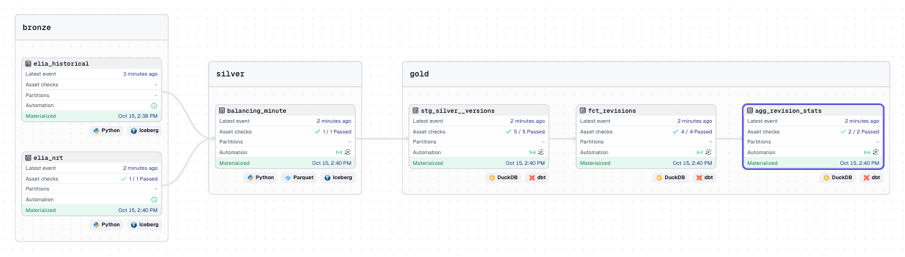
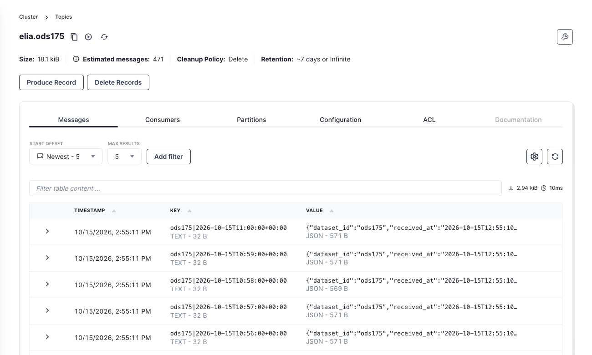
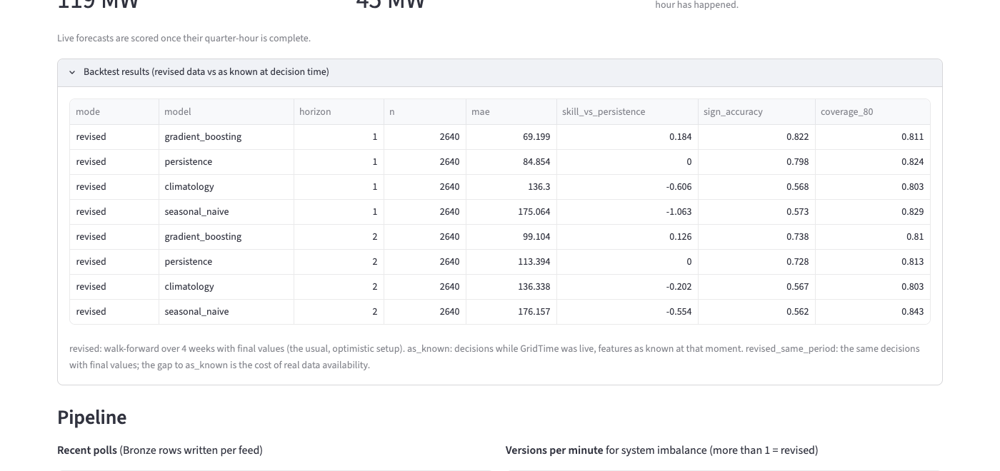

# GridTime

A bitemporal lakehouse for the Belgian electricity grid, built on [Elia Open Data](https://opendata.elia.be).

Elia's grid data is revised after the fact: forecasts are refreshed every minute, and near-real-time
values are published as non-validated and later replaced by validated ones. GridTime keeps **every
version** of every value, stamped with two times:

- `valid_time` – the quarter-hour the value describes
- `transaction_time` – when GridTime received it

That makes "as-of" questions answerable: *what did we know about 14:00–14:15 at 14:07?* This is the
foundation for honest forecast evaluation without data leakage.


**Time travel.** The *As known at* slider rewinds the dashboard to any past moment. Rewound to
13:59:45, the historical feed (which arrived at 14:00:54) disappears, because GridTime did not
know it yet:


## Architecture

```
Elia API → pollers → Redpanda → Bronze sink → Bronze (raw) → Silver (bitemporal) → Gold (dbt)
   storage: MinIO (S3) + Iceberg · streaming: Redpanda · Gold: dbt on DuckDB · orchestration: Dagster
```

See [docs/architecture.md](docs/architecture.md).

## Milestones

| # | Milestone | New tools | Status |
|---|-----------|-----------|--------|
| 1 | Ingest Elia data into Bronze | MinIO, Iceberg (PyIceberg) | Done |
| 2 | Bitemporal Silver layer | – | Done |
| 3 | Orchestration + Gold models | Dagster, dbt | Done |
| 4 | Streaming buffer | Redpanda | Done |
| 5 | Forecasting + evaluation | scikit-learn, MLflow | Done |
| 6 | Platform upgrade | Trino, Nessie, Soda | Planned |

## Quick start

Requirements: Docker, Python 3.12, [uv](https://docs.astral.sh/uv/).

```bash
cp .env.example .env
make up        # start MinIO and create the lakehouse bucket
make install   # install Python dependencies
make init      # create the Iceberg tables
make ingest    # poll Elia once into Redpanda, then drain the topics into Bronze
make backfill  # optional: 8 weeks of Elia history (needed for forecasting)
make silver    # turn new Bronze rows into bitemporal Silver versions
make peek      # query Bronze with DuckDB
make dashboard # open the dashboard at http://localhost:8501
```

Or let Dagster run it all on a schedule (Bronze every 5 min / hourly, Silver and Gold
rebuilt automatically after each poll):

```bash
make orchestrate   # Dagster UI at http://localhost:3000
```



## Streaming

Pollers publish every observation to Redpanda (`elia.ods175`, `elia.ods165`); invalid
records go to `elia.dlq`. The Bronze sink drains the topics, drops payloads Bronze already
has, appends the rest and only then commits offsets: at-least-once delivery, exactly-once
storage. See [decisions/004](docs/decisions/004-streaming-buffer.md).



## Forecasting

GridTime forecasts the mean system imbalance of the next two quarter-hours and evaluates the
forecasts **as they would have been known**. The same feature function runs on the latest
data (the usual, optimistic backtest) and on Silver *as of* each decision time, where the last
minutes of the previous quarter-hour have often not been published or polled yet.

| Next quarter-hour (4-week walk-forward, 2,640 decisions) | MAE | Skill vs persistence | Sign right | 80% interval coverage |
|---|---|---|---|---|
| Gradient boosting (quantile, conformal) | 69 MW | **+18%** | 82% | 81% |
| Persistence | 85 MW | 0% | 80% | 82% |
| Climatology (by quarter-hour of day) | 136 MW | −61% | 57% | 80% |
| Same quarter-hour yesterday | 175 MW | −106% | 57% | 83% |

Imbalance is persistent, not daily-seasonal: yesterday's value is worse than no model. The
as-known evaluation and the log of live forecasts (scored once each quarter-hour completes)
grow every day; the dashboard shows both. See
[decisions/005](docs/decisions/005-forecasting-and-as-known-evaluation.md).



```bash
make forecast   # retrain, run both backtests, make a live forecast
make mlflow     # MLflow UI at http://localhost:5001
```

## Gold models (dbt)

| Model | Grain | What it answers |
|-------|-------|-----------------|
| `fct_balancing_minute` | minute | Latest known value of all 12 measures, wide |
| `fct_quarter_hour` | quarter-hour | Imbalance and prices at settlement resolution |
| `fct_revisions` | minute × measure | First near-real-time value vs historical value |
| `agg_revision_stats` | measure | How often and how much Elia revises each measure |

Every model is tested (`make gold`); in Dagster the dbt tests appear as asset checks.

MinIO console: http://localhost:9001 (credentials in `.env`) · Redpanda Console:
http://localhost:8080 (topics, messages, consumer lag).

## Querying the past

```python
from datetime import datetime, UTC
from gridtime.storage.tables import silver_table
from gridtime.transform import asof

silver = silver_table().scan().to_arrow()
asof.as_of(silver, datetime(2026, 10, 15, 12, 7, tzinfo=UTC))   # what we knew at 12:07
asof.history(silver, datetime(2026, 10, 15, 12, 0, tzinfo=UTC), "system_imbalance")
asof.revisions(silver, "system_imbalance")                       # first published vs historical
```

## Troubleshooting

- **`uv sync` fails building `dbt-core-experimental-parser` with an SSL certificate error
  (macOS).** Point the build at certifi's bundle:
  `SSL_CERT_FILE=$(uv run python -m certifi) uv sync`

## Repository layout

```
src/gridtime/
  config.py            settings loaded from .env
  ingestion/           Elia client, schemas, poller (producer), Redpanda plumbing, Bronze sink
  storage/             Iceberg catalog connection and table definitions
  transform/           Bronze → Silver: canonical measures, versioning, as-of reads
  orchestration/       Dagster assets, schedules, checks
  forecasting/         features, models, revised + as-known backtests, live forecasts
  dashboard/           Streamlit app and the queries behind it
transforms/            dbt project (Gold)
tests/                 unit tests
docs/                  architecture and decision records
```
