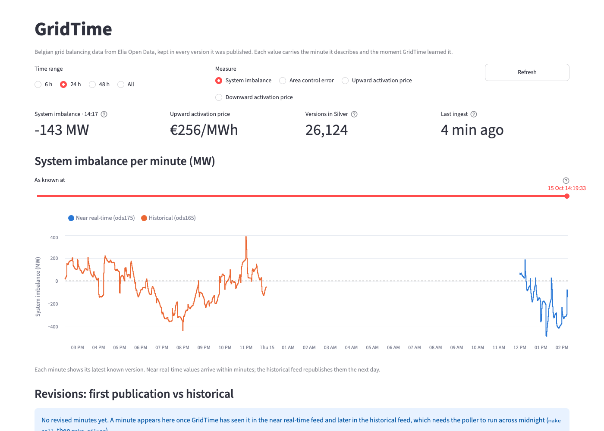
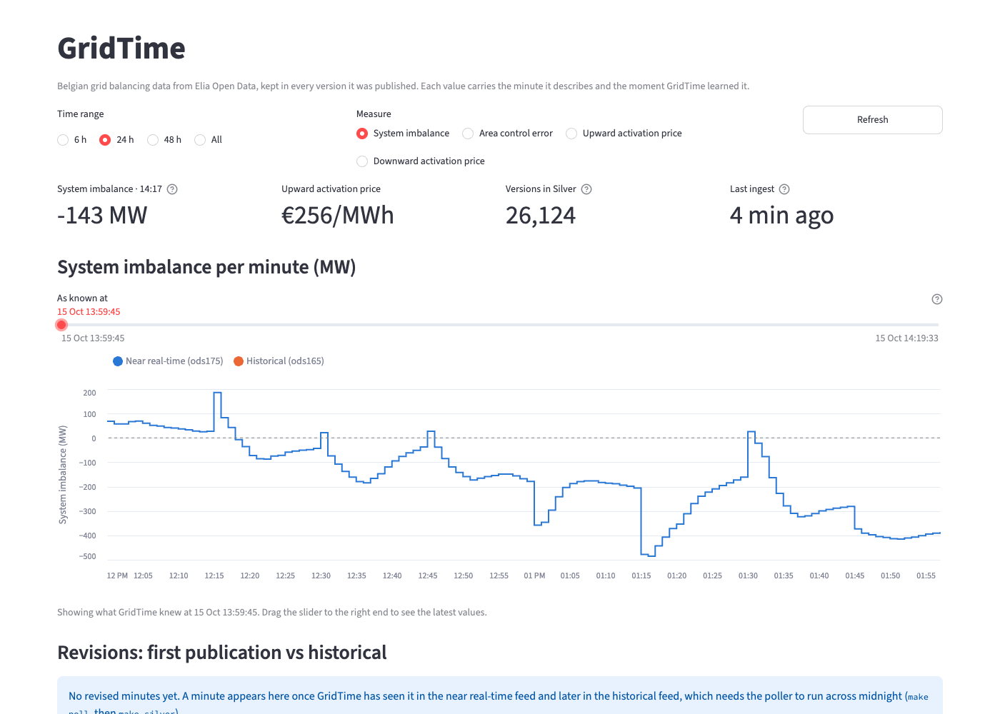

# GridTime

A bitemporal lakehouse for the Belgian electricity grid, built on [Elia Open Data](https://opendata.elia.be).

Elia's grid data is revised after the fact: forecasts are refreshed every minute, and near-real-time
values are published as non-validated and later replaced by validated ones. GridTime keeps **every
version** of every value, stamped with two times:

- `valid_time` – the quarter-hour the value describes
- `transaction_time` – when GridTime received it

That makes "as-of" questions answerable: *what did we know about 14:00–14:15 at 14:07?* This is the
foundation for honest forecast evaluation without data leakage.



**Time travel.** The *As known at* slider rewinds the dashboard to any past moment. Rewound to
13:59:45, the historical feed (which arrived at 14:00:54) disappears, because GridTime did not
know it yet:



## Architecture

```
Elia API → pollers → Bronze (raw, append-only) → Silver (bitemporal) → Gold (dbt) → analysis
                         storage: MinIO (S3) · catalog: PyIceberg SQL catalog
```

See [docs/architecture.md](docs/architecture.md).

## Milestones

| # | Milestone | New tools | Status |
|---|-----------|-----------|--------|
| 1 | Ingest Elia data into Bronze | MinIO, Iceberg (PyIceberg) | Done |
| 2 | Bitemporal Silver layer | – | Done |
| 3 | Orchestration + Gold models | Dagster, dbt | Planned |
| 4 | Streaming buffer | Redpanda | Planned |
| 5 | Forecasting + evaluation | statsforecast, mlforecast, MLflow | Planned |
| 6 | Platform upgrade | Trino, Nessie, Soda | Planned |

## Quick start

Requirements: Docker, Python 3.12, [uv](https://docs.astral.sh/uv/).

```bash
cp .env.example .env
make up        # start MinIO and create the lakehouse bucket
make install   # install Python dependencies
make init      # create the Iceberg tables
make ingest    # poll Elia once and write to Bronze
make silver    # turn new Bronze rows into bitemporal Silver versions
make peek      # query Bronze with DuckDB
make dashboard # open the dashboard at http://localhost:8501
```

MinIO console: http://localhost:9001 (credentials in `.env`).

## Querying the past

```python
from datetime import datetime, UTC
from gridtime.storage.tables import silver_table
from gridtime.transform import asof

silver = silver_table().scan().to_arrow()
asof.as_of(silver, datetime(2026, 10, 15, 12, 7, tzinfo=UTC))   # what we knew at 12:07
asof.history(silver, datetime(2026, 10, 15, 12, 0, tzinfo=UTC), "system_imbalance")
asof.revisions(silver, "system_imbalance")                       # first published vs historical
```

## Repository layout

```
src/gridtime/
  config.py            settings loaded from .env
  ingestion/           Elia client, payload schemas, poller
  storage/             Iceberg catalog connection and table definitions
  transform/           Bronze → Silver: canonical measures, versioning, as-of reads
  dashboard/           Streamlit app and the queries behind it
tests/                 unit tests
docs/                  architecture and decision records
```
