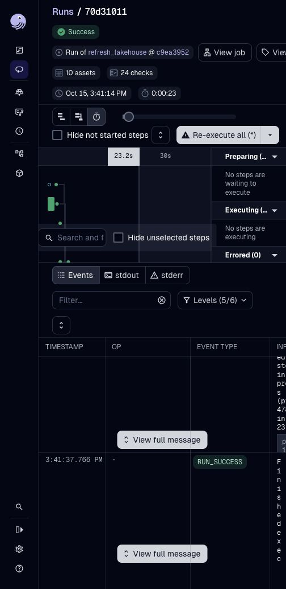
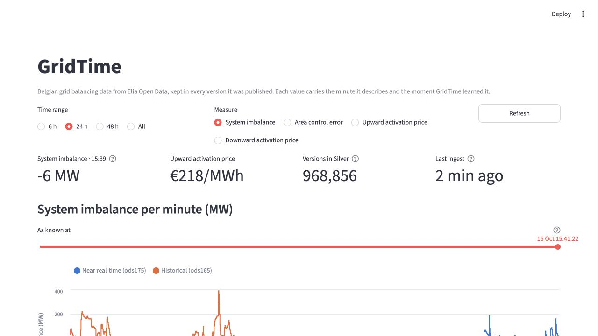

# 006 — Nessie, Trino and a Soda publication gate

Date: 2026-10-15. Status: implemented and verified locally.

## Decision

Nessie 0.104.3 is the Iceberg REST catalog, with its version store persisted in a
Docker RocksDB volume. MinIO keeps the existing data and metadata objects. Trino
476 reads those Iceberg tables directly. dbt-trino builds staging and all four Gold
models as Iceberg tables; the Silver Parquet export and DuckDB Gold database are no
longer part of the pipeline. DuckDB remains an in-process query engine for the
Python transformations and dashboard.

Two static Trino catalogs select Nessie references: `lakehouse` reads `main`, and
`lakehouse_wap` reads `silver-wap`. Both use the container's MinIO endpoint; host
PyIceberg uses localhost. Nessie's secret properties use their dotted names because
the uppercase environment-variable spelling did not resolve the access-key name.
The readiness check runs on Nessie's internal management port 9000.

## Write, audit, publish

1. Acquire the local WAP file lock and capture `main`'s hash.
2. Reset `silver-wap` to that hash using optimistic concurrency.
3. Read Bronze and append new Silver versions on that branch, including the Bronze
   watermark in the Iceberg snapshot. Published Silver does not advance yet.
4. Run `quality/silver.yml` through Soda Core and Trino's `lakehouse_wap` catalog.
5. Require a nonempty scan with every check passing and no execution error. Verify
   that the branch still points to the audited hash.
6. Merge exactly that hash into `main`, supplying the original expected main hash.
   A rejected merge is an error; an unchanged branch is a successful audited no-op.

Failed candidates receive an `audit-failed-*` tag. JSON audit reports remain under
`data/quality/`. The next run resets the working branch and reprocesses from the
published watermark. Silver's low-level writer rejects REST catalogs outside the
WAP branch. Dagster serializes runs, while the file lock also protects two local
manual WAP runs. Multiple hosts would require a distributed lease.

Soda checks cover Bronze identity/nullability, Silver version uniqueness, stages,
finite values and valid intervals, and Gold uniqueness, quarter-hour completeness
bounds and revision arithmetic. Missing measure values and Elia's `DataIssue` flags
are retained as source facts. They are not automatically pipeline corruption.
Bronze's Dagster Soda check blocks downstream execution. Silver is audited before
publication and checked again on main. Gold checks run after its dependent models
finish; Gold does not have an atomic multi-table publication gate in this milestone.

The gate guarantees rejection of the conditions encoded by its checks. It cannot
guarantee detection of every kind of bad data or prevent direct administrative
writes to the unauthenticated local development catalog.

## Catalog migration and recovery

With writers stopped, `make migrate` uses SQLite's backup API, registers the two
existing table metadata locations in Nessie, and verifies row counts, table UUIDs,
schemas and current snapshot IDs. It never rewrites or copies the underlying data.
Nessie adds catalog properties and exposes a reduced snapshot history in REST
responses, so comparing the whole returned metadata object is inappropriate.

During this migration the initial graceful Dagster shutdown did not stop its daemon.
One subsequent Bronze append added five observations to Nessie. The daemon was then
stopped fully. The recovery verification explicitly allowed that appended destination,
checked every original data file was still present, and preserved the five new rows.
The normal migration command refuses a destination that has already diverged.

| Table | Frozen SQLite rows | Nessie rows at verification |
|---|---:|---:|
| Bronze | 80,726 | 80,731 |
| Silver | 968,712 | 968,712 |

`data/catalog-migration.json` records metadata locations, counts and backup path.
SQLite and its backups remain intact, but **they are frozen at cutover**, not a
continuously updated replica. `CATALOG_BACKEND=sqlite` permits recovery inspection;
Silver WAP refuses to run in that mode. Do not resume ingestion against the frozen
catalog as if it were current. Before a writable rollback, stop all writers, preserve
Nessie's current metadata pointers and Kafka offsets, and register those current
pointers into a separate SQL catalog with count verification. If Nessie is unavailable,
restoring the old catalog also requires replay/reconciliation of post-cutover data.
Do not delete shared MinIO objects or expire snapshots as part of rollback.

## SQL changes

Window subqueries replace `QUALIFY`; explicit grouping replaces `GROUP BY ALL`;
`max_by` replaces `arg_max`; quarter-hour bucketing uses `date_trunc` and `date_add`.
Gold's median and p95 now use Trino's `approx_percentile`, so these two statistics
are approximate. All models use table replacement rather than a Parquet handoff.
The live dataset has no matched NRT/historical revisions yet; the revision tables
are allowed to be empty until observations span the historical publication delay.

## Validation

- dbt: five Iceberg models built, all 18 data tests passed, including a repeated build.
- Soda: six Bronze, eight Silver, and ten Gold checks passed.
- Invalid-candidate demonstration: appended one duplicate on the audit branch;
  Soda rejected it. Main remained at 968,772 Silver rows with the same catalog hash
  and metadata location, while the rejected candidate held 968,773 rows.
- Rejected evidence retained as `demo-rejected-20261015T133933614233Z`;
  `data/quality/failure-demo.json` records the proof. The working branch was reset.
- Nessie's catalog HEAD survived a container restart.
- Dagster run `70d31011-6ecd-46d0-8cf2-23b6bb3c4b29` completed in 23 seconds:
  ten assets materialized (including a live forecast), all 24 asset checks passed.
- All 63 Python tests passed; lint and whitespace checks are clean. Tests cover audit failures, unavailable audit connections, empty scans,
  changes during audit, merge conflicts, and no-op publication, alongside the existing
  bitemporal and forecasting tests. `make test` runs without Docker for unit coverage.

To reproduce integration validation, start the services, run `make quality` and
`make gold`, then launch `refresh_lakehouse` from Dagster. Stop Dagster and other
writers before `make failure-demo`; it intentionally writes only to the audit branch.
Train the forecast model once with `make forecast` on a new installation before
launching a full refresh that includes live forecasting.

References: [Nessie 0.104.3 configuration](https://projectnessie.org/nessie-0-104-3/configuration/),
[Nessie Iceberg REST with Trino](https://projectnessie.org/iceberg/trino/),
[Soda Trino configuration](https://docs.soda.io/soda-documentation/soda-v3/data-source-reference/connect-trino).
